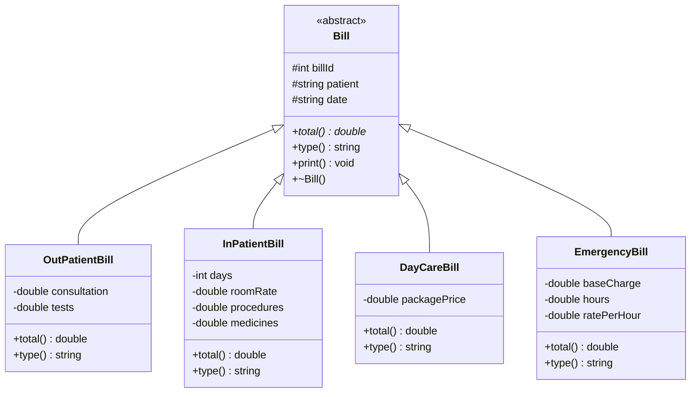

# Task A1 – Design the Polymorphic Bill Hierarchy (7 Marks)

## A1.1 – Common Interface
**Operations every bill must provide**

| Operation | Purpose |
|-----------|---------|
| `total()` | compute the amount of the bill (different for every kind of bill) |
| `type()` | name of the bill kind, e.g. "OP", "IP", "DC", "ER" |
| `print()` | show type, patient and total (same for all, so written once) |
| virtual destructor | so a bill can be deleted safely through a `Bill*` |

**Data common to all bills:** `billId`, `patient` name, `date`.

**Data that belongs only to a kind of bill**
| Bill | Own data |
|------|----------|
| OutPatient | consultation fee, tests |
| InPatient | days, room rate per day, procedures, medicines |
| DayCare | package price |
| Emergency | base charge, hours, rate per hour |

## A1.2 – Design the Hierarchy

**Which function is what?**

| Function | In `Bill` | In derived classes |
|----------|-----------|--------------------|
| `total()` | **pure virtual** (`= 0`) – `Bill` is abstract | **overridden** in every derived class |
| `type()` | **virtual** (default returns "Bill") | **overridden** |
| `~Bill()` | **virtual** | destructors of derived classes also virtual automatically |
| `print()` | ordinary (non-virtual): written once, calls the virtual `total()` and `type()` | not overridden |

## A1.3 – Process All Bills Together (pseudocode)
```
ALGORITHM DayTotal
INPUT : bills[0..n-1]  – array of pointers to Bill (any kind), n
OUTPUT: sum – total of all bills of the day
BEGIN
  sum ← 0
  FOR i ← 0 TO n − 1 DO
      sum ← sum + bills[i].total()      // virtual call: the right formula runs for each kind
  END FOR
  RETURN sum
END
```
*(Adapt the keywords/layout to the SIMATS pseudocode standard from your course material.)*

## Alternative Concept and Complexity Analysis
**Alternative:** one `Bill` structure with a `type` field and a `switch` in `total()`.
```
STRUCT Bill: type, patient, fee1, fee2, days, rate, hours ...      // all fields for all kinds
FUNCTION total(b)
  SWITCH b.type
    CASE OP : RETURN b.fee1 + b.fee2
    CASE IP : RETURN b.days * b.rate + b.fee1
    CASE DC : RETURN b.fee1
    CASE ER : RETURN b.fee1 + b.hours * b.rate
END
```
| Point | Abstract base + virtual | One struct + switch |
|-------|------------------------|---------------------|
| Time to total n bills | **O(n)** – one virtual call per bill | **O(n)** – one switch per bill |
| Space per bill | only the fields of that bill + one vtable pointer (8 bytes) | **all** fields in every bill (unused ones wasted) |
| New bill type | write **one new class**; nothing existing is edited | edit the enum, the `switch` in `total()`, the struct, and every other `switch` |
| Safety | compiler forces `total()` to be defined (pure virtual) | forgetting a `case` compiles silently |

