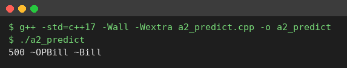
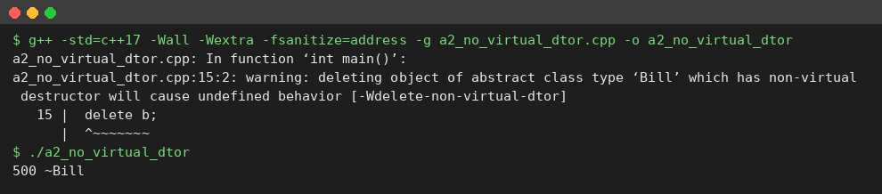

# Task A2 – Understand Runtime Binding (5 Marks)

## A2.1 – Early and Late Binding
Take `Bill* b = new OPBill; b->total();`

| | Early (compile-time) binding | Late (run-time) binding |
|---|-----------------------------|-------------------------|
| Decided | by the compiler | while the program runs |
| Based on | the **type of the pointer** (`Bill*`) | the **real type of the object** (`OPBill`) |
| Used for | normal (non-virtual) functions | `virtual` functions |
| Speed | fastest, direct call | tiny extra cost (one pointer lookup) |
| Result of `b->total()` | would call `Bill::total()` | calls `OPBill::total()` |

## A2.2 – The Virtual Table
Every class with virtual functions has one **vtable** (a table of function addresses). Every object has a hidden **vptr** pointing to the vtable of its **real class**.

```
vtable of Bill (abstract)           vtable of OutPatientBill            vtable of InPatientBill
+----+--------------------+         +----+------------------------+     +----+------------------------+
| 0  | Bill::~Bill        |         | 0  | OutPatientBill::~...   |     | 0  | InPatientBill::~...    |
| 1  | total = pure (0)   |         | 1  | OutPatientBill::total  |     | 1  | InPatientBill::total   |
| 2  | Bill::type         |         | 2  | OutPatientBill::type   |     | 2  | InPatientBill::type    |
+----+--------------------+         +----+------------------------+     +----+------------------------+
```
**How `b->total()` reaches the right function**
```
 Bill* b  ───►  [ vptr | patient | consultation | tests ]   (an OutPatientBill object)
                    │
                    ▼
         vtable of OutPatientBill  →  slot 1  →  OutPatientBill::total()
```
1. `b` points to the object. 2. The compiler reads the object's **vptr**. 3. It takes **slot 1** of that vtable (the slot for `total`). 4. It jumps to that address. If `b` points to an `InPatientBill`, the vptr points to the other vtable, so `InPatientBill::total()` runs. Same call, different result.

## A2.3 – Virtual Destructors
`delete b;` where `b` is a `Bill*` pointing to a derived object. If `~Bill()` is **not** virtual, only `~Bill()` runs (undefined behaviour): the derived destructor is skipped, so any memory the derived class owns (e.g. an array of tests) **leaks**. With a **virtual** destructor the vtable sends `delete` to the derived destructor first, then `~Bill()`.

## Predict the Output
Code: [`a2_predict.cpp`](a2_predict.cpp)

**My predicted output (write yours BEFORE running):** `500 ~OPBill ~Bill `

**Actual:**  → matches.

**How does the non-virtual `show()` reach `OPBill::total()`?** `show()` is just an ordinary function, but inside it the call `total()` is really `this->total()`, and `total()` is virtual. So the call is looked up through the object's vptr and ends in `OPBill::total()` (500). Destruction: `~OPBill` runs first, then the base `~Bill`.

**Remove `virtual` from `~Bill`** ([`a2_no_virtual_dtor.cpp`](a2_no_virtual_dtor.cpp))

* **Predicted:** `500 ~Bill ` (the `~OPBill` is missing) and the compiler warns about deleting through a base pointer.
* **Actual (with `-fsanitize=address`):** 
* The warning `-Wdelete-non-virtual-dtor` appears and `~OPBill` is missing, as predicted. AddressSanitizer reports **nothing here** because `OPBill` has no data of its own: no memory is lost and both classes have the same size.
* To make the damage visible, [`a2_leak_demo.cpp`](a2_leak_demo.cpp) gives `OPBill` a heap array. ASan then reports `new-delete-type-mismatch` (and the array would leak): 

## Alternative Concept and Complexity Analysis
**Alternative:** `total()` is **not** virtual; the program finds the real type with `dynamic_cast`.
```
FUNCTION total(b)
  IF   p ← dynamic_cast<OutPatientBill*>(b) is not null THEN RETURN p.consultation + p.tests
  ELSE IF p ← dynamic_cast<InPatientBill*>(b) is not null THEN RETURN p.days * p.rate + ...
  ELSE IF ... (one test for every bill type)
END
```
| Point | Virtual function | `dynamic_cast` chain |
|-------|------------------|----------------------|
| Time per bill | **O(1)** – one vtable lookup | **O(k)** – up to k casts for k bill types (each cast is also slower than a virtual call) |
| Space | one vptr (8 bytes) per object | the same: `dynamic_cast` needs the vtable/RTTI, so the vptr is still there |
| New bill type | one new class | add another `else if` in **every** function that uses the chain |

## Viva – say it simply
* Virtual function → call decided **at run time** by the **object**; non-virtual → decided **at compile time** by the **pointer type**.
* vptr = hidden pointer in each object; vtable = one table per class of function addresses.
* No virtual destructor → derived part is not destroyed → leak / undefined behaviour.
