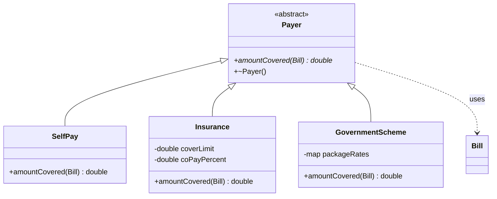

# Task A3 – Design with Abstract Classes (5 Marks)

## A3.1 – Payer Interface

`amountCovered(const Bill&)` is the **pure virtual** function: it returns the amount **this payer pays** for that bill. The patient pays `bill.total() − amountCovered(bill)` where there is a co-payment.

| Payer | Rule (pseudocode) | Example |
|-------|-------------------|---------|
| SelfPay | `RETURN bill.total()` (the patient pays everything) | bill 49200 → 49200 |
| Insurance | `eligible ← MIN(bill.total(), coverLimit)` ; `RETURN eligible × (100 − coPayPercent) / 100` | bill 60000, limit 50000, co-pay 10% → 45000 |
| GovernmentScheme | `RETURN fixed package rate for bill.type()`; if the code has no package → **throw** `UnknownPackageError` | type "IP" rate 30000 → 30000 |

```
ALGORITHM InsuranceCovered
INPUT : bill, coverLimit, coPayPercent
OUTPUT: amount paid by the insurance company
BEGIN
  eligible ← MIN(bill.total(), coverLimit)
  RETURN eligible × (100 − coPayPercent) / 100
END
```

## A3.2 – Extension: a new payer without changing existing classes
Write one **new class** in a **new file**; do not edit `Payer`, `SelfPay`, `Insurance`, `GovernmentScheme`, `Bill` or any bill class.
```
CLASS CorporatePayer INHERITS Payer
    DATA discountPercent, companyLimit
    FUNCTION amountCovered(bill)
        RETURN MIN(bill.total(), companyLimit) × discountPercent / 100
END CLASS
```
The billing loop already works with `Payer*`, so `payer->amountCovered(bill)` calls the new class automatically. **Existing classes changed: 0.**

## Alternative Concept and Complexity Analysis
**Alternative:** the payer is a **function** chosen at run time (`std::function<double(const Bill&)>` or a function pointer).
```
policy ← FUNCTION(bill) → MIN(bill.total(), 50000) × 0.9     // lambda; the limit is captured inside
covered ← policy(bill)
```
| Point | Abstract `Payer` class | `std::function` / function pointer |
|-------|------------------------|------------------------------------|
| Time per call | **O(1)** – vtable lookup | **O(1)** – call through the stored function (usually a little slower for `std::function`) |
| Space per payer | one vptr + its data members (e.g. `coverLimit`, `coPayPercent` = ~24 bytes) | a plain function pointer = **8 bytes** (it cannot hold data); `std::function` = **32 bytes** on g++ (+ heap if the captured data is large) |
| Where is the cover limit kept? | in a named, typed **member variable**, visible and changeable, and the class can have other functions (name, print, validate) | hidden in the **lambda capture** (for `std::function`) or in a global/extra argument (function pointer): hard to inspect or print |
| Best for | payers with several data items and several operations | small, one-line rules |

