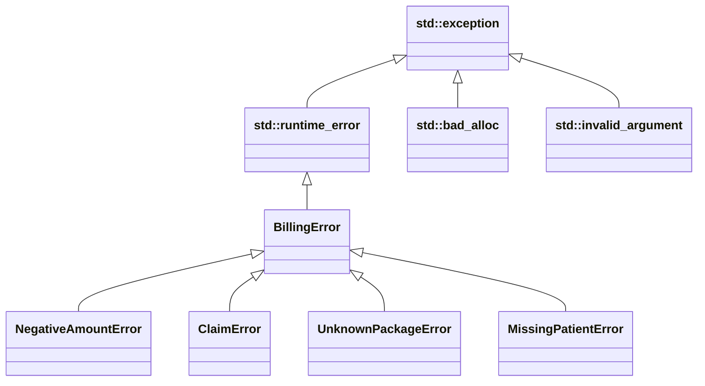

# Task A4 – Design the Exception Strategy (4 Marks)

## A4.1 – Identify the Errors
| # | Error | Detected where | Exception thrown |
|---|-------|----------------|------------------|
| 1 | Negative charge (fee, days, rate) | bill constructor / `total()` | `NegativeAmountError` |
| 2 | Claim above the cover limit | `Insurance::amountCovered()` | `ClaimError` |
| 3 | Unknown package code | `GovernmentScheme::amountCovered()` | `UnknownPackageError` |
| 4 | Missing patient record | patient lookup | `MissingPatientError` |
| 5 | Memory allocation failure | `new` / big container | `std::bad_alloc` (thrown by C++ itself) |
| 6 | Text where a number is expected | `std::stod` | `std::invalid_argument` (thrown by the library) |

**Exception class hierarchy**

All billing errors derive from `BillingError` (which derives from `std::runtime_error`, so it has `what()`). One `catch (const BillingError&)` handles every billing problem, a more specific `catch (const ClaimError&)` handles just claims, and `catch (const std::exception&)` catches everything, including the library errors.

## A4.2 – Specify Exceptions
| May throw | Must never throw → mark `noexcept` |
|-----------|-------------------------------------|
| constructors that validate data | destructors (they are `noexcept` by default) |
| `Payer::amountCovered()` (claim / package errors) | `type()`, `patient()`, getters |
| patient lookup, string-to-number conversion | `what()` of the exception classes |
| anything that allocates memory (`new`) | simple helpers such as `swap`, and the final reporting function |

```cpp
std::string type() const noexcept { return "OP"; }    // example
```
*(C++17 uses `noexcept`; the old `throw(...)` specification was removed.)*

**Why destructors must not throw:** during stack unwinding the destructors of local objects run. If a destructor throws while another exception is already active, C++ has two exceptions at once and calls **`std::terminate`**, so the program ends immediately and nothing is saved. Destructors must therefore clean up quietly.

## Alternative Concept and Complexity Analysis
**Alternative:** report errors with **return codes**.
```
enum Status { OK, NEGATIVE, OVER_COVER, UNKNOWN_PACKAGE }
FUNCTION approve(billed, cover, OUT paid) → Status
    IF billed < 0 THEN RETURN NEGATIVE
    IF billed > cover THEN RETURN OVER_COVER
    paid ← billed ; RETURN OK
CALLER: s ← approve(...) ; IF s ≠ OK THEN handle(s)   // after EVERY call, at EVERY level
```
| Point | Exceptions | Return codes |
|-------|------------|--------------|
| Normal path time | no cost per call (the checks are free until something is thrown) | one small `if` after every call (tiny) |
| Error path time | **slow** – stack unwinding, roughly microseconds per throw | **fast**, O(1) – just a return |
| Extra space | none on the normal path (tables kept by the compiler) | an extra output parameter / status value on every function |
| Code needed | error handling is written once in the `catch` | every function in the chain must check and pass the code back; forgetting a check **silently loses the error** |

