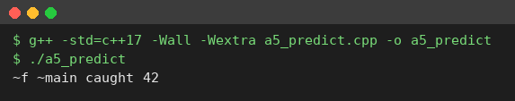

# Task A5 – Design Recovery and Rethrowing (4 Marks)

## A5.1 – Where to Catch
| Level | Function | What it does with the exception |
|-------|----------|----------------------------------|
| 1 | `approve()` / `Payer::amountCovered()` / constructors | **throw** `NegativeAmountError`, `ClaimError`, `UnknownPackageError` |
| 2 | `settleClaim()` | **catch `ClaimError`, log it ("audit: …"), rethrow with `throw;`** (it cannot fix the claim; it only records it) |
| 3 | `processDay()` loop | **catch `BillingError` for each bill**, store the bill in a "rejected" list with the reason, and **continue with the next bill** → no bill is lost |
| 4 | `main()` | last safety net: `catch (const std::exception&)` (includes `std::bad_alloc`, `invalid_argument`) and `catch (...)`: **report to the user** and exit cleanly |

```
ALGORITHM ProcessDay
INPUT : bills[0..n-1], payer
OUTPUT: paidTotal, rejected list
BEGIN
  FOR i ← 0 TO n − 1 DO
      TRY
          paidTotal ← paidTotal + settleClaim(bills[i], payer)
      CATCH BillingError e
          ADD (bills[i], e.what()) TO rejected          // bill kept, reason recorded
      END TRY
  END FOR
  RETURN paidTotal, rejected
END
```
Use **`throw;`** (not `throw e;`) to rethrow: it passes on the **original** exception object with its full type; `throw e;` would copy only the static type of `e` (object slicing).

## A5.2 – No Leaks on Errors
**Stack unwinding:** when an exception is thrown, C++ leaves the current function and every function up the call stack until a matching `catch` is found. On the way out it **destroys every local object** of each function it leaves, in reverse order of creation.

**RAII (Resource Acquisition Is Initialization):** a resource (memory, file) is owned by an object whose **destructor releases it** (`std::unique_ptr`, `std::vector`, `std::string`, `std::ifstream`). Because the destructor runs during unwinding, the memory/file is released **automatically even when an exception passes through**. No `delete` or `close` has to be written in a `catch`.

## Predict the Output
Code: [`a5_predict.cpp`](a5_predict.cpp)

**My predicted output (write yours BEFORE running):** `~f ~main caught 42`

**Actual:**  → matches.

* `f()` throws `42`. Unwinding leaves `f` first → `Guard g("f")` is destroyed → `~f`.
* Control then leaves the `try` block → `Guard m("main")` is destroyed → `~main`. This happens **before** the handler runs.
* The matching handler `catch (int x)` prints `caught 42`. `catch (...)` is not used because the first match wins.
* `"not printed "` never appears because after `throw`, the rest of `f()` and the rest of the `try` block are skipped.

## Alternative Concept and Complexity Analysis
**Alternative:** release memory with `delete` in every `catch` block (no RAII).
```
p ← new Bill[...]
TRY    ... work ...
CATCH ClaimError   : delete p ; ...        // must repeat in EVERY catch block
CATCH BillingError : delete p ; ...
CATCH ...          : delete p ; ...
delete p                                    // and again on the normal path
```
| Point | RAII (`unique_ptr`, `vector`) | `delete` in each `catch` |
|-------|------------------------------|--------------------------|
| Time | same | same |
| Code size | small – no cleanup code in handlers | longer – cleanup repeated in every handler and on the normal path |
| Places where a leak can occur | **0** (the destructor always runs) | at least one per exit path; **every new error path or new `catch` adds another place** (n paths → n possible leaks, e.g. a `return` or a new exception type with no cleanup) |

## Viva – say it simply
* **Unwinding** = C++ walks back up the calls, destroying local objects on the way.
* **RAII** = let an object's destructor do the cleanup, so exceptions cannot cause leaks.
* **`throw;`** rethrows the same exception; **`throw e;`** makes a copy and may slice it.
