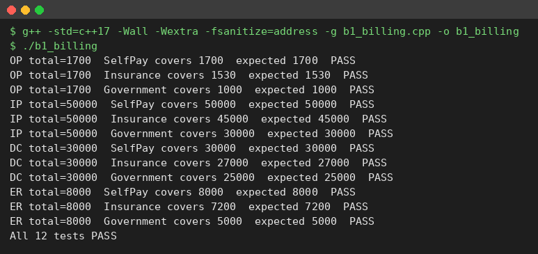
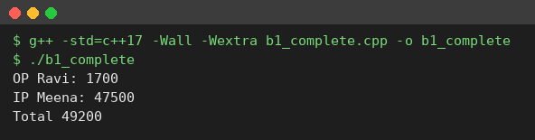

# Task B1 – Implement and Validate the Polymorphic Billing (7 Marks)
Files: `billing.h` (all classes), `b1_billing.cpp`, `b1_complete.cpp`, `b1_no_virtual_total.cpp`, `b1_no_virtual_dtor.cpp`, `b1_alt_template.cpp`

## B1.1 – Validate the Implementation
Code: `billing.h` + `b1_billing.cpp` (compiled with `-fsanitize=address`)  Output: 

**Hand calculation (bills)**
| Bill | Data | Total |
|------|------|-------|
| OP (Ravi) | 500 + 1200 | **1700** |
| IP (Meena) | 3 × 2500 + 40000 + 2500 | **50000** |
| DC (Arun) | package | **30000** |
| ER (Kavya) | 2000 + 4 × 1500 | **8000** |

**Hand calculation (payers)** – Insurance: limit 50000, co-pay 10 % → `min(total, 50000) × 0.90`. Government: fixed rates OP 1000, IP 30000, DC 25000, ER 5000 → `min(total, rate)`.

| Bill | SelfPay | Insurance | Government |
|------|---------|-----------|------------|
| OP 1700 | 1700 | 1700 × 0.9 = **1530** | **1000** |
| IP 50000 | 50000 | 50000 × 0.9 = **45000** | **30000** |
| DC 30000 | 30000 | 30000 × 0.9 = **27000** | **25000** |
| ER 8000 | 8000 | 8000 × 0.9 = **7200** | **5000** |

The program prints all 12 values with the expected values and **PASS** for each; the sanitizer reports nothing.

## B1.2 – Compare with Your Design
| Part A design | Code | Why changed |
|---------------|------|-------------|
| Government returns the fixed package rate | returns `min(total, rate)` | a scheme should never pay more than the bill |
| Bills only compute totals | constructors check charges with `nonNeg()` and throw `NegativeAmountError` | needed for the exception design (A4) |
| Payer interface only | added `name()` and the helper `approveClaim()` (throws `ClaimError`) | for printing results and rejecting claims above cover |
| `type()` for display | also used by `GovernmentScheme` to find the package rate | one function serves two uses |

## B1.3 – Prove Runtime Binding
Code: `b1_no_virtual_total.cpp` (reduced program: `total()` has no `virtual`, `Bill::total()` returns 0)  Output: 

Through `Bill*`, the call is bound at compile time to `Bill::total()` (the pointer type), so the output is **0, 0, day total 0** instead of 1700, 47500, **49200**. The derived `total()` only *hides* the base one. With `virtual` the object's real type decides.

## B1.4 – Prove the Virtual Destructor
Code: `b1_no_virtual_dtor.cpp` (`~Bill()` not virtual; `InPatient` owns a `std::vector`)

* Compiler warning: `-Wdelete-non-virtual-dtor` – "will cause undefined behavior".
* AddressSanitizer result 1: **`new-delete-type-mismatch`** (allocated 32 bytes, deleted as 8 bytes). 
* Result 2 (`ASAN_OPTIONS=new_delete_type_mismatch=0`): **LeakSanitizer – 800 bytes leaked** (the vector's 100 doubles). 

With `virtual ~Bill()` both reports disappear (see the clean run in B1.1 and B4).

## Complete the Code
Code: `b1_complete.cpp`
```cpp
// TODO 1
virtual double total() const = 0;
virtual std::string type() const { return "Bill"; }
// TODO 2 (OutPatient)
double total() const override { return consultation + tests; }
std::string type() const override { return "OP"; }
// TODO 3 (InPatient)
double total() const override { return days * perDay + surgery; }
std::string type() const override { return "IP"; }
```
Output (matches expected): 

**Remove `virtual` from `total()` → compiler error:**
```
error: initializer specified for non-virtual method 'double Bill::total() const'
error: 'double OutPatient::total() const' marked 'override', but does not override
error: 'double InPatient::total() const' marked 'override', but does not override
```
Reason: `= 0` (pure specifier) is allowed only on virtual functions, and `override` needs a virtual function in the base.

## Alternative Concept and Complexity Analysis
**Alternative:** templates (compile-time polymorphism), one container per bill type – `b1_alt_template.cpp`  Output: 
```
TEMPLATE sumAll(container of B)  : sum ← sum + b.total() for each b     // B known at compile time
day ← sumAll(opBills) + sumAll(ipBills)                                  // one call per container
```
| Point | Virtual + base pointer | Templates, one container per type |
|-------|------------------------|-----------------------------------|
| Time per bill | O(1) – virtual call (indirect, hard to inline) | O(1) – direct call, can be inlined (no virtual call) |
| Space | one vptr per object + one pointer per element | **no vptr**; objects stored directly; but **one container per type** |
| All kinds in one list? | **yes** (`Bill*` array) | **no** – no single element type holds OP and IP |
| New bill type | one new class | one more container + one more `sumAll` call in every place that processes bills |


