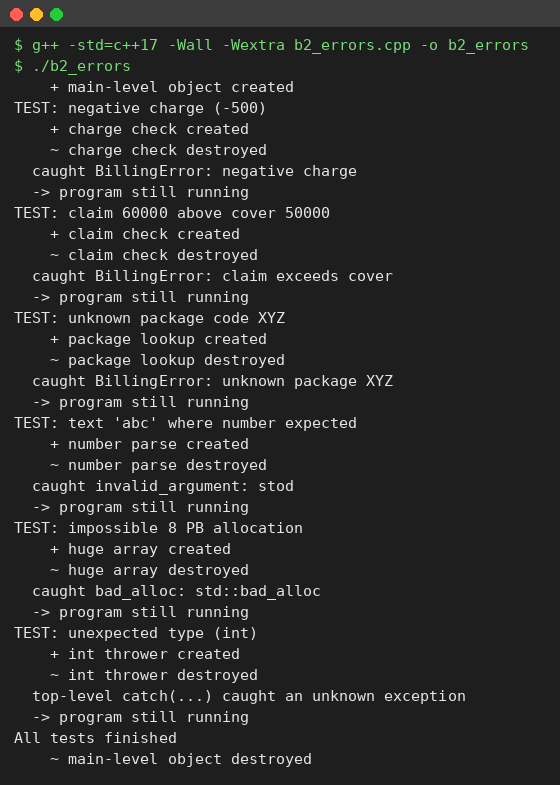
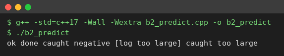
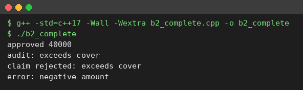
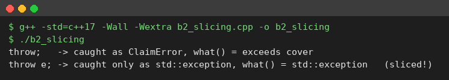

# Task B2 – Engineer Error Conditions (5 Marks)
Files: `b2_errors.cpp`, `b2_predict.cpp`, `b2_complete.cpp`, `b2_slicing.cpp`, `b2_alt_optional.cpp`

## Error tests
Code: `b2_errors.cpp`  Output (normal run): 
Output (AddressSanitizer run, `-DNO_HUGE`):  – no sanitizer report.

*(AddressSanitizer aborts on an impossible `new` instead of throwing `bad_alloc`, so that one test is skipped in the ASan run and shown in the normal run.)*

| Test | Result | What it reveals |
|------|--------|-----------------|
| negative charge | `BillingError` caught | one `catch (BillingError&)` handles all billing rules |
| claim above cover | `BillingError` (ClaimError) caught | derived exceptions are caught by the base-class handler |
| unknown package XYZ | `BillingError` caught | the lookup fails safely with a clear reason |
| `stod("abc")` | `std::invalid_argument` caught | library errors need their own (or a `std::exception`) handler |
| 8 PB allocation | `std::bad_alloc` caught | memory failure is recoverable; the program continues |
| `throw 7` (an int) | top-level `catch (...)` | nothing escapes; the program keeps running |
In **every** test the message `~ … destroyed` appears before the catch message: **stack unwinding destroys all local objects**. "program still running" after each test and `~ main-level object destroyed` at the end show nothing is lost.

## Predict the Output
Code: `b2_predict.cpp`

**My predicted output (write yours BEFORE running):** `ok done caught negative [log too large] caught too large `

**Actual:**  → matches.

| Value | Path |
|-------|------|
| 100 | no error: `validate` prints `ok `, `process` returns, `main` prints `done ` |
| −5 | `invalid_argument` thrown. `process` only has `catch (const std::out_of_range&)`, which does not match, so it passes straight through. `main`'s `catch (const std::exception&)` catches it: `caught negative` |
| 2e6 | `out_of_range` thrown. `process` **matches**, logs `[log too large]`, rethrows with `throw;`. `main` catches it: `caught too large` |

Only one exception was logged because only `out_of_range` has a handler in `process`.

## Complete the Code
Code: `b2_complete.cpp`
```cpp
// TODO 1
if (billed < 0 || cover < 0) throw std::invalid_argument("negative amount");
if (billed > cover) throw ClaimError("exceeds cover");
return billed;
// TODO 2
std::cout << "audit: " << e.what() << '\n';
throw;
```
Output (matches expected): 

**`throw;` vs `throw e;`** (`b2_slicing.cpp`): `throw;` rethrows the **original object** with its real type. `throw e;` throws a **copy of the static type of `e`**. In the given program `e` is declared `const ClaimError&`, so the copy is also a `ClaimError` and the output is **identical** (I tested it). The difference appears when the handler's parameter is a base type:   
`catch (const exception& e) { throw e; }` slices the object to `std::exception`: the `ClaimError` handler no longer matches and `what()` becomes "std::exception". Always use `throw;`.

## Alternative Concept and Complexity Analysis
**Alternative:** `std::optional<double>` (no value = rejected) – `b2_alt_optional.cpp` (`-O2`)  Output: 
```
FUNCTION approve(x) → optional : IF x < 0 THEN RETURN nothing ELSE RETURN x
CALLER : r ← approve(x) ; IF r has value THEN use it ELSE count rejection
```
Measured on my machine, 1,000,000 claims (your numbers will differ – run it yourself):

| Invalid claims | Exceptions | `optional` |
|----------------|-----------|------------|
| 0 % | 2.9 ms | 2.9 ms |
| 1 % | 12.0 ms | 2.9 ms |
| 50 % | 645 ms | 7.1 ms |

* **Time:** O(n) for both. Normal path equal; the error path of an exception costs about 1 µs per throw (stack unwinding), so exceptions become very slow when errors are common.
* **Space:** `sizeof(double)` = 8, `sizeof(optional<double>)` = 16 (value + "has value" flag).
* **Trade-off:** `optional` is fast but carries **no reason** for the rejection and every caller must check it; exceptions carry a message and propagate automatically, but are meant for **rare** errors.

## Viva – say it simply
* Handlers are tried in order; the first matching type wins. `catch (...)` catches anything.
* `throw;` = pass the same exception on. `throw e;` = copy (may slice).
* Exceptions: rare errors, readable code. `optional`/return codes: frequent "errors".
