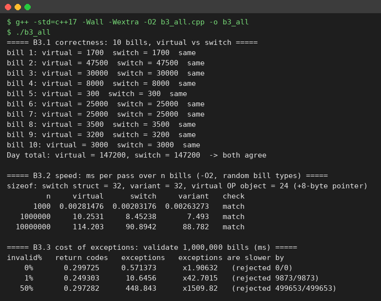

# Task B3 – Virtual Functions vs switch vs Exceptions: The Cost (8 Marks)
Files: `b3_all.cpp` (one program for B3.1, B3.2, B3.3 and the variant alternative) and `output_b3_all.png` (one output).

Compile and run: `g++ -std=c++17 -Wall -Wextra -O2 b3_all.cpp -o b3_all && ./b3_all`



*(Times are from my machine and change a little from run to run – run it yourself and put your own numbers in your report; the pattern stays the same.)*

## B3.1 – Correctness on Small Data
The same 10 bills give the **same total in both versions**, day total **147200** (printed as "both agree").

## B3.2 – Increase the Data Size
Time (ms) for one pass over n bills in random order (the sums match in all cases):
| n | virtual | switch | `std::variant` |
|---|---------|--------|----------------|
| 1,000 | 0.0028 | 0.0020 | 0.0026 |
| 1,000,000 | 10.25 | 8.45 | 7.49 |
| 10,000,000 | 114.2 | 90.9 | 88.8 |

## B3.3 – Cost of Exceptions
Time to validate 1,000,000 bills:
| Invalid bills | Return codes | Exceptions | Exceptions are |
|---------------|--------------|------------|----------------|
| 0 % | 0.30 ms | 0.57 ms | ×1.9 |
| 1 % | 0.25 ms | 10.6 ms | ×43 |
| 50 % | 0.30 ms | 449 ms | ×1510 |

## B3.4 – Engineering Trade-Off
**Virtual vs switch.** Both are O(n). Virtual was about **20–25 % slower** (114 ms vs 91 ms at 10 million bills). Every bill is a separate heap object reached through a pointer (an extra memory access) and called indirectly, whereas the switch reads one compact array. The difference is small compared with the benefit of adding a new bill type without editing old code.

**Exceptions.** With no errors the cost is tiny (both well under 1 ms). Each throw costs about **1 µs** (449 ms ÷ 500,000 throws ≈ 0.9 µs) because the program must unwind the stack and find a handler. Return codes cost almost nothing on the error path.

**When to use each**
| Approach | Use when |
|----------|----------|
| Virtual functions | many kinds of objects in one list and new kinds are added often (this hospital system) |
| switch / type field | a small, fixed set of types and speed is critical |
| `std::variant` + `visit` | a fixed set of types, no heap allocation, fastest here |
| Exceptions | errors are **rare** (≪ 1 %) and must be handled far from where they occur |
| Return codes | errors are **common**, or the code is a tight loop |

## Alternative Concept and Complexity Analysis
**Alternative:** `std::variant<OPv, IPv, DCv, ERv>` processed with `std::visit` (measured in the same program).
```
bills ← array of variant ; FOR each b : sum ← sum + VISIT(b, x → x.total())
```
* **Time:** O(n). For 10,000,000 bills: variant 88.8 ms ≈ switch 90.9 ms < virtual 114.2 ms (bills are stored contiguously: no pointers, no vtable).
* **Space per element:** size of the largest alternative + tag = 24 + 8 = **32 bytes** (measured `sizeof` = 32). Virtual: a 24-byte object + an 8-byte pointer, plus heap overhead for every object.
* **Cost:** the set of types is fixed at compile time; adding a type means changing the `variant` list.

## Viva – say it simply
* Virtual costs a little (indirect call + pointer chasing) but gives easy extension.
* Exceptions are almost free when nothing goes wrong and expensive when thrown, so use them only for exceptional cases.
