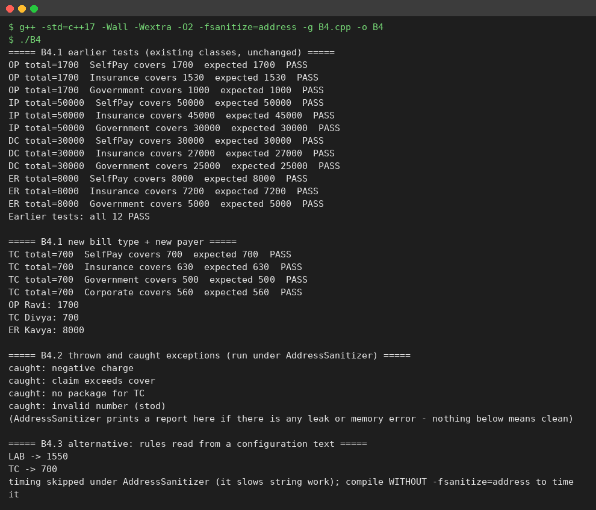

# Task B4 – Final Engineering Decision (5 Marks)
Files: `B4.cpp` (one program for B4.1, B4.2 and the alternative) and `Output_B4.png` (one output).

Tests + sanitizer (B4.1, B4.2): `g++ -std=c++17 -Wall -Wextra -O2 -fsanitize=address -g B4.cpp -o B4 && ./B4`
Timing (B4.3 alternative): `g++ -std=c++17 -Wall -Wextra -O2 B4.cpp -o B4 && ./B4` (timing is skipped under the sanitizer because it slows string work)



## B4.1 – Implement a Practical Extension
The program has two parts: **PART 1** is the existing code from B1 (bills, payers, exceptions, `runBaseTests()`), copied **unchanged**; **PART 2** is new code only.

* **New bill type:** `TeleConsultBill` (type `TC`): minutes × per-minute rate + platform fee → 30 × 20 + 100 = **700**.
* **New payer:** `CorporatePayer`: `min(total, 5000) × 80 %` → **560**.
* **Existing classes changed: 0.** The Government rate for `TC` (500) is passed in as data from `main`.
* **Earlier tests still pass:** the 12 tests from B1 run first – all **PASS**. The new type was tested with every payer: Self 700, Insurance 630, Government 500, Corporate 560 – all PASS (hand-calculated). The new `TeleConsultBill` also works in the same `Bill*` array and loop as the old types.

## B4.2 – Check Resource Safety
The run above is compiled with `-fsanitize=address` and includes **four thrown and caught exceptions** (negative charge, claim above cover, unknown package, invalid number) and heap objects deleted through `Bill*`. **AddressSanitizer printed no report** – no leak, no invalid access.

## B4.3 – Production Decision
**Decision: Yes – the polymorphic design with exceptions is suitable.**

| Evidence | Finding |
|----------|---------|
| Load | 200,000 bills/day. Measured in B3: 10,000,000 virtual calls take ≈ 114 ms, so a whole day's bills (200,000) take ≈ **2.3 ms**. Speed is not a problem. |
| Errors | If 5 % of bills are rejected = 10,000 throws × ≈ 1 µs ≈ **10 ms**; even 50 % invalid ≈ 0.1 s. Exceptions are acceptable because rejections are the exception, not the rule. |
| Extension effort | 2 new bill types + 3 new payers a year = **5 new classes, 0 edits** to existing classes (B4.1). Earlier tests keep passing, so the regression risk is low. |
| Safety | A clean sanitizer report with exceptions, a virtual destructor, and no leaks. |

Conditions: use `std::unique_ptr` / containers instead of raw `new`, keep the tests (like `runBaseTests()`) in the build, run them under ASan, and use return codes or `optional` only for bulk checks where most records may be invalid.

## Alternative Concept and Complexity Analysis
**Alternative:** new bill types described in a **configuration file** instead of C++ classes. In the program the file contents are the text `TC 30 20 100` / `LAB 5 300 50` (type, units, per-unit rate, fixed fee); a real project would read the same lines from `rates.txt`.
```
READ config → rules[type] ← (units, perUnit, fixedFee)
total(bill) ← rules[bill.type].fixedFee + rules[bill.type].units × rules[bill.type].perUnit
```
Measured without the sanitizer (10,000,000 bills, my machine, three runs): rule interpretation **≈ 37–39 ms**, virtual call **≈ 25–28 ms**.

| Point | New C++ classes | Configuration (plug-in) rules |
|-------|-----------------|-------------------------------|
| Time per bill | one virtual call (≈ 26 ms per 10 M bills) | a name lookup (hash the string) + formula (≈ 38 ms per 10 M bills, about 1.4× slower) |
| Space | one class per type (code) + one vptr per object | a small rule per type (24 bytes) + the map |
| Who can add a type | a programmer; compile, test, deploy | anyone who can edit a file; no recompile |
| Flexibility | any logic at all (checks, exceptions, special cases) | only formulas the interpreter understands (here: fixed + units × rate) |
| Risk | errors found by the compiler and tests; no effect on old types | a typo in the file is found only **at run time**; a wrong rule affects live bills |

**Recommendation:** classes for rules with real logic (payers with limits and co-pay), configuration for simple tariff types (like `TC`, `LAB`).
